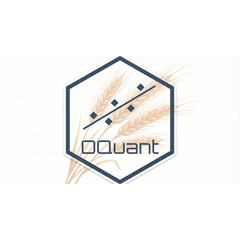

::: {.rh-section}

```{=html}
<div style="display:flex; flex-wrap:wrap; align-items:center; gap:2rem;">
  <div style="flex:1 1 380px; min-width:280px;">
    <div class="rh-kicker">OQuant Data Science Consulting</div>
  </div>
  <div style="flex:0 0 auto;">
    
  </div>
</div>
```

## Turning data into defensible decisions

OQuant is an independent data science consultancy founded in March 2025 by Rodrigo Hermont Ozon — economist, econometrician, and PhD researcher in Systems and Industrial Engineering. The premise is simple: business decisions deserve the same rigor as peer-reviewed research. OQuant combines econometric modeling, statistical validation, and modern AI engineering to deliver analyses you can defend in front of a board, an auditor, or a regulator — not black boxes, and not slideware.

:::

::: {.rh-section}

```{=html}
<div class="rh-kicker">Services</div>
```

## What OQuant does

```{=html}
<div style="display:grid; grid-template-columns:repeat(auto-fit,minmax(260px,1fr)); gap:1.1rem;">
  <div class="rh-card">
    <h3>Forecasting &amp; Time Series</h3>
    <p>Demand, price, and volatility forecasting with classical econometrics (ARIMA, GARCH-family, GAMLSS, Bayesian MSGARCH) and machine learning hybrids — with honest out-of-sample validation, not curve-fitting.</p>
  </div>
  <div class="rh-card">
    <h3>Econometric Modeling &amp; Causal Inference</h3>
    <p>Answering "what actually drives this?" — regression diagnostics, panel and instrumental-variable methods, quasi-experimental designs, and Bayesian multicausal models grounded in economic theory.</p>
  </div>
  <div class="rh-card">
    <h3>Risk Analytics &amp; Simulation</h3>
    <p>Quantitative risk measurement and scenario analysis: Monte Carlo simulation, extreme value modeling, portfolio and multi-objective optimization for pricing, sourcing, and investment decisions.</p>
  </div>
  <div class="rh-card">
    <h3>Machine Learning &amp; Predictive Modeling</h3>
    <p>Supervised and deep learning models (including CNN+LSTM architectures and survival analysis for predictive maintenance) built with proper feature engineering, ablation testing, and MLOps discipline.</p>
  </div>
  <div class="rh-card">
    <h3>Business Intelligence &amp; Decision Support</h3>
    <p>KPI frameworks, dashboards, and analytical pipelines that turn scattered data into a single, trusted view — from data modeling and governance documentation to executive-ready reporting.</p>
  </div>
  <div class="rh-card">
    <h3>Generative AI for Business</h3>
    <p>Practical LLM applications: internal chatbots, multi-agent and sub-agent workflow orchestration, and AI-assisted knowledge management — designed around your processes, with measurable value.</p>
  </div>
</div>
```

:::

::: {#packages .rh-section}

```{=html}
<div class="rh-kicker">How to start</div>
```

## Engagement packages

Fixed scope, fixed timeline and a fixed fee agreed before any work starts. The fee depends on your data and your context, so every proposal is quoted individually.

```{=html}
<div style="display:grid; grid-template-columns:repeat(auto-fit,minmax(260px,1fr)); gap:1.1rem;">
  <div class="rh-card">
    <h3>Data &amp; AI Diagnostic</h3>
    <p>The best first step: find out where data and AI can actually move your numbers.</p>
    <ul>
      <li>Interviews with up to 4 people from leadership and operations</li>
      <li>Inventory of the data you already have, and how far it can be trusted</li>
      <li>3 prioritized opportunities, each with estimated gain and effort</li>
      <li>A 90-day plan and a 1-hour presentation to leadership</li>
    </ul>
    <p style="font-family:'IBM Plex Mono',monospace; font-size:.78rem; letter-spacing:.02em;">Timeline: 2 weeks</p>
  </div>
  <div class="rh-card">
    <h3>AI &amp; Data Workshop for Managers</h3>
    <p>For leaders who need to decide where AI fits in the company, and where it does not.</p>
    <ul>
      <li>Up to 25 participants</li>
      <li>Hands-on exercise with your own data, anonymized</li>
      <li>Material that stays with your team</li>
    </ul>
    <p style="font-family:'IBM Plex Mono',monospace; font-size:.78rem; letter-spacing:.02em;">Duration: 8 hours, over two mornings</p>
  </div>
  <div class="rh-card">
    <h3>Custom Forecasting</h3>
    <p>Demand, price, claims or default forecasts your planning can rely on.</p>
    <ul>
      <li>One target variable and up to 3 data sources</li>
      <li>Models compared against a simple benchmark, with out-of-sample testing</li>
      <li>Uncertainty bands, not just a single number</li>
      <li>Executive report, documented code and a simple dashboard</li>
      <li>2-hour handover training and 30 days of support</li>
    </ul>
    <p>See it working in the <a href="portfolio/hospital-admissions.html">hospital admissions case</a>, tested on all 27 Brazilian states, and applied to default in the <a href="portfolio/credit-early-warning.html">corporate credit early-warning case</a> and to price in the <a href="portfolio/mobility-dynamic-pricing.html">ride-hailing dynamic pricing case</a>.</p>
    <p style="font-family:'IBM Plex Mono',monospace; font-size:.78rem; letter-spacing:.02em;">Timeline: 6 weeks</p>
  </div>
  <div class="rh-card">
    <h3>Reliable AI Assistant (pilot)</h3>
    <p>An assistant that answers questions about your documents or data, and never invents a number.</p>
    <ul>
      <li>One use case and one data source (documents or tables)</li>
      <li>20 test questions you approve as the acceptance criterion</li>
      <li>Every figure checked against the source before it is shown</li>
      <li>Runs in your environment, under your control</li>
    </ul>
    <p>See it working in the <a href="portfolio/hybrid-rag.html">hybrid RAG case</a>, and the same guardrail in the <a href="portfolio/multiagent-commodities.html">multi-agent commodity analyst</a>.</p>
    <p style="font-family:'IBM Plex Mono',monospace; font-size:.78rem; letter-spacing:.02em;">Timeline: 6 weeks</p>
  </div>
  <div class="rh-card">
    <h3>Fractional Head of Data</h3>
    <p>Senior data leadership one day a week, without a full-time hire.</p>
    <ul>
      <li>Priorities and roadmap for data and AI</li>
      <li>Monitoring and recalibration of models in production</li>
      <li>Mentoring for your analysts</li>
      <li>Support on new questions as they come up</li>
    </ul>
    <p style="font-family:'IBM Plex Mono',monospace; font-size:.78rem; letter-spacing:.02em;">Monthly, minimum of 3 months</p>
  </div>
</div>
<p style="margin-top:1.2rem;"><a class="rh-btn rh-btn-primary" href="#quote">Request a quote for your project</a></p>
```

:::

::: {.rh-section}

```{=html}
<div class="rh-kicker">Selected clients</div>
```

## Organizations OQuant has served

```{=html}
<div style="display:grid; grid-template-columns:repeat(auto-fit,minmax(260px,1fr)); gap:1.1rem;">
  <div class="rh-card">
    <h3>Grupo Fleury</h3>
    <p>Consulting work for one of Brazil's leading healthcare and diagnostic medicine groups.</p>
  </div>
  <div class="rh-card">
    <h3>Aurora Alimentos</h3>
    <p>Consulting work for one of Brazil's largest food industry cooperatives.</p>
  </div>
  <div class="rh-card">
    <h3>Cogna Educacional</h3>
    <p>Consulting work for one of Brazil's largest education companies.</p>
  </div>
</div>
```

Client engagements are confidential; sector references are shared with permission and project details remain under NDA.

:::

::: {.rh-section}

```{=html}
<div class="rh-kicker">How I work</div>
```

## A disciplined engagement model

```{=html}
<div class="rh-timeline">
  <div class="rh-tl-item">
    <div class="rh-tl-date">Step 1</div>
    <h3>Diagnostic</h3>
    <div class="rh-tl-org">Understand the decision, not just the data</div>
    <p>We start with the business question and the decision it must inform. I audit the available data, map the constraints, and define success criteria before a single model is fit. If the data cannot support the question, you hear that on week one — not at delivery.</p>
  </div>
  <div class="rh-tl-item">
    <div class="rh-tl-date">Step 2</div>
    <h3>Modeling &amp; validation</h3>
    <div class="rh-tl-org">Rigor before results</div>
    <p>Candidate models are built, stress-tested, and compared against honest baselines with out-of-sample and backtesting protocols. Assumptions are documented, uncertainty is quantified, and every result comes with its limitations stated plainly.</p>
  </div>
  <div class="rh-tl-item">
    <div class="rh-tl-date">Step 3</div>
    <h3>Deployment &amp; handoff</h3>
    <div class="rh-tl-org">Production code, not a PDF</div>
    <p>Deliverables are reproducible: versioned code, documented pipelines, and dashboards or APIs your team can own. I train your people so the solution outlives the engagement.</p>
  </div>
  <div class="rh-tl-item">
    <div class="rh-tl-date">Step 4</div>
    <h3>Monitoring &amp; advisory</h3>
    <div class="rh-tl-org">Models drift; decisions evolve</div>
    <p>Optional ongoing support: performance monitoring, model recalibration, and advisory sessions as new questions emerge — so the analytics keep pace with the business.</p>
  </div>
</div>
```

:::

::: {.rh-section}

```{=html}
<div class="rh-kicker">Why OQuant</div>
```

## What you are actually buying

```{=html}
<div style="display:grid; grid-template-columns:repeat(auto-fit,minmax(260px,1fr)); gap:1.1rem;">
  <div class="rh-card">
    <h3>PhD-level rigor</h3>
    <p>Active doctoral research in multi-objective optimization, Bayesian econometrics, and time series at PUCPR, an MSc in Economic Development (UFPR), peer-reviewed publications, and reviewer roles for journals such as <em>Applied Soft Computing</em>. The methods behind your project are the ones surviving academic scrutiny.</p>
  </div>
  <div class="rh-card">
    <h3>18+ years of industry track record</h3>
    <p>Hands-on delivery inside large organizations — Volvo Group, BRF, CNH Industrial, Unimed — plus UNDP/UN research work and years of economic analysis for industry federations. I know how corporate data, politics, and deadlines actually behave.</p>
  </div>
  <div class="rh-card">
    <h3>End-to-end capability</h3>
    <p>From statistical theory to production code: econometric specification, Python/R/SQL implementation, cloud data pipelines (Azure, Databricks, PySpark), and MLOps. One consultant covers the full path from hypothesis to deployed system.</p>
  </div>
</div>
```

```{=html}
<div class="rh-logos">
  
  
  
  
  
  
</div>
```

:::

::: {#quote .rh-section}

```{=html}
<div class="rh-kicker">Next step</div>
```

## Request a quote for your project

Tell me in a few lines what decision you need to make, what data you have and when you need it. You will receive a proposal with scope, timeline and a fixed fee. The first conversation costs nothing, and it usually clarifies whether quantitative modeling can move your decision.

```{=html}
<div style="display:flex; flex-wrap:wrap; gap:0.8rem; margin-top:1rem;">
  <a class="rh-btn rh-btn-primary" href="https://calendly.com/rhozon/30min">Book a 30-min call</a>
  <a class="rh-btn rh-btn-ghost" href="mailto:contato.oquant@gmail.com?subject=Quote%20request">Email</a>
  <a class="rh-btn rh-btn-ghost" href="https://wa.me/5541988382904">WhatsApp</a>
  <a class="rh-btn rh-btn-ghost" href="https://www.linkedin.com/in/rodrigohermontozon/">LinkedIn</a>
</div>
<p style="margin-top:.8rem; font-size:.92rem;">contato.oquant@gmail.com</p>
```

:::
