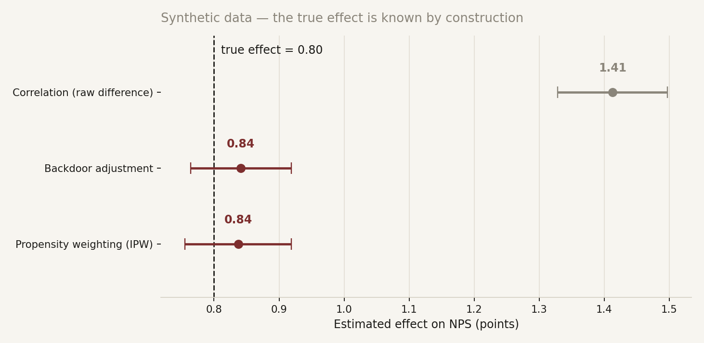

::: {.rh-section}
<div class="rh-kicker">Case Study 04 · Synthetic data</div>
# Causal Modeling of NPS

<p style="font-family:'IBM Plex Mono',monospace; font-size:.8rem; letter-spacing:.02em;">
Causal inference · Backdoor adjustment · Propensity weighting · Python
</p>

```{=html}
<div class="rh-card" style="border-left:3px solid #7d2e2e;">
  <p style="margin:0;"><strong>Every number and every chart on this page comes from
  simulated data.</strong> The real engagement behind this method is covered by a
  non-disclosure agreement: the client is not named, and none of its data, figures or
  findings appear here or anywhere else on this site. What is shown is the method,
  running on data generated by the script at the bottom of the page.</p>
</div>
```
:::

::: {.rh-section}
## The business question

A company runs a customer-success programme — a proactive call to accounts that look like
they need help. Six months in, the accounts that got the call have a visibly better Net
Promoter Score. Leadership wants to expand the programme.

Should they? The dashboard shows a gap. It does not show whether the programme *caused*
the gap, or whether the team simply called the accounts that were already going to be
happy — the big ones, the long-tenured ones, the ones with few complaints. Expanding a
programme on the strength of that gap can burn a budget on something that does nothing.
:::

::: {.rh-section}
## The data

Simulated: 6,000 accounts, each with a size, a tenure, a support-ticket count, whether it
received the intervention, and an NPS score.

The confounding is deliberate, and it is the whole point. In the simulator, bigger and
longer-tenured accounts are **both** more likely to receive the call **and** happier to
begin with. That is exactly the structure that makes a raw comparison misleading, and it
is what real customer-success data looks like.

**Why synthetic is the right choice here, not a compromise.** With client data nobody
reading this page could check whether the causal estimate is correct — the true effect is
unobservable, which is the whole difficulty of the field. Here the true effect is a
constant written in the code. That makes the estimator gradeable: you can see whether it
recovers the answer, and by how much it misses.
:::

::: {.rh-section}
## Method, and why this one

**The naive comparison, for reference.** Difference in mean NPS between treated and
untreated accounts. This is what a dashboard reports, and it is the number the decision
would otherwise rest on.

**Backdoor adjustment.** Regress NPS on the intervention while conditioning on the
variables that drive both the intervention and the outcome — size, tenure, ticket count.
Blocking those paths leaves the causal effect.

**Propensity weighting.** Model the probability of receiving the call given the same
covariates, then weight each account by the inverse of that probability. This rebuilds a
population in which treatment is as good as randomly assigned, and it makes a different
set of assumptions than the regression — so agreement between the two is informative,
and disagreement would be a warning.

Two estimators rather than one, on purpose. A single causal estimate is a claim; two that
rest on different assumptions and land in the same place is evidence.
:::

::: {.rh-section}
## Result



The true effect written into the simulator is **0.80 NPS points**.

The raw comparison reports **1.41** — it overstates the programme by roughly three
quarters, because it is crediting the intervention with the head start of the accounts
that received it. A team that expanded the programme on that number would find the
returns quietly failing to materialise.

Both causal estimators land at **0.84**, within their confidence intervals of the truth,
and they agree with each other despite resting on different assumptions.

The point is not the decimals. It is that the gap between 1.41 and 0.80 is the difference
between a programme that justifies its budget and one that mostly re-labels customers who
were already loyal — and no amount of extra dashboard filtering would have revealed it.
:::

::: {.rh-section}
## Code

The script generates the data, runs all three estimators and produces the chart above.
It is self-contained and deterministic — same seed, same numbers:

```{=html}
<p><a class="rh-btn rh-btn-primary" href="nps-causal-demo.py">nps-causal-demo.py</a></p>
```

```bash
python nps-causal-demo.py
```

Requires `numpy`, `pandas`, `statsmodels` and `matplotlib`. Change `EFEITO_VERDADEIRO` at
the top and rerun: the naive estimate moves with the confounding, the adjusted ones follow
the truth.
:::

::: {.rh-section}
## References

- Austin, P. C. and Stuart, E. A. (2015). Moving towards best practice when using inverse probability of treatment weighting (IPTW) using the propensity score to estimate causal treatment effects in observational studies. *Statistics in Medicine*, 34(28), 3661-3679. [doi:10.1002/sim.6607](https://doi.org/10.1002/sim.6607)
- Hirano, K., Imbens, G. W. and Ridder, G. (2003). Efficient Estimation of Average Treatment Effects Using the Estimated Propensity Score. *Econometrica*, 71(4), 1161-1189. [doi:10.1111/1468-0262.00442](https://doi.org/10.1111/1468-0262.00442)
- Keiningham, T. L., Cooil, B., Andreassen, T. W. and Aksoy, L. (2007). A Longitudinal Examination of Net Promoter and Firm Revenue Growth. *Journal of Marketing*, 71(3), 39-51. [doi:10.1509/jmkg.71.3.039](https://doi.org/10.1509/jmkg.71.3.039)
- Pearl, J. (2009). Causality: Models, Reasoning, and Inference, 2nd ed. *Cambridge University Press*. [doi:10.1017/CBO9780511803161](https://doi.org/10.1017/CBO9780511803161)
- Rosenbaum, P. R. and Rubin, D. B. (1983). The central role of the propensity score in observational studies for causal effects. *Biometrika*, 70(1), 41-55. [doi:10.1093/biomet/70.1.41](https://doi.org/10.1093/biomet/70.1.41)
:::
