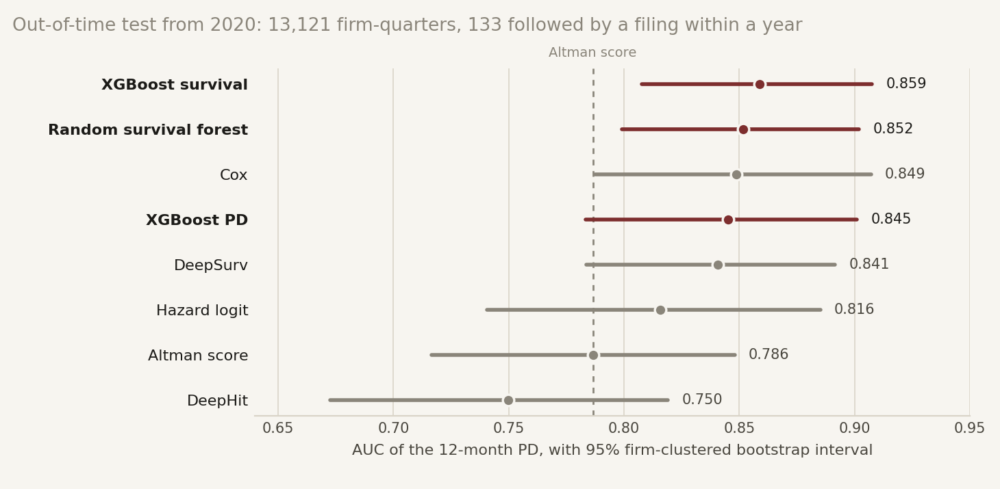

::: {.rh-section}
<div class="rh-kicker">Case Study 08 · Results under revision</div>
# Corporate Credit Early Warning

<p style="font-family:'IBM Plex Mono',monospace; font-size:.8rem; letter-spacing:.02em;">
Survival analysis · XGBoost · DeepSurv · DeepHit · Language-model signals · Agents with a numeric guardrail · Systematic review · Python · 192 tests
</p>
:::

::: {.rh-section}
## The business question

When a large company files for judicial recovery, the losses land on banks, bondholders,
credit funds and the suppliers who sold to it on credit. Oi filed twice, in 2016 and 2023.
Americanas filed in January 2023, days after it disclosed an accounting inconsistency.
Light followed in May 2023. After each case a credit committee asks the same question: was
there something in the public record, a year earlier, that should have changed the
decision?

Since January 2025 the question also has a regulatory form. CMN Resolution 4,966 asks
Brazilian lenders to provision for expected loss: the next 12 months for exposures in good
standing, the whole remaining term once credit risk has increased significantly. That needs
a probability of default for each horizon, not a single score, and it needs to notice the
increase early.
:::

::: {.rh-section}
## The data

Everything is public. Quarterly and annual statements of every listed company come from the
CVM open-data portal, each dated by the day it reached the regulator, so the model only sees
what an analyst could have seen at the time. The auditor's report is read for the
going-concern paragraph. Material facts, the filings a company must publish when something
relevant happens, carry the early news: a debt renegotiation, a covenant waiver, an asset
sale to raise cash, a CFO who leaves. Interest rates, inflation, activity, unemployment and
corporate default come from the Central Bank.

The hard part is the outcome. No public table lists when each listed company entered
judicial or out-of-court recovery; the registry shows only the current status. The event
base was rebuilt from three public traces (the registry, the filings of companies in
recovery and the material facts that announce a filing), with a language model separating
the company's own filing from a customer's or a subsidiary's, and then checked by a second
model that reads the filings of each event, under a fixed rule. It holds 103 events in 87 companies since 2011.
:::

::: {.rh-section}
## Method, and why this one

**One panel, one test, eight models.** Each listed non-financial company contributes one row
per quarter, with what was known at the end of that quarter. Firms that left the market
without an event stay in the data until they leave, so the sample does not keep only the
survivors. The models go from the classical to the recent: the Altman score in its version
for emerging markets, a discrete-time hazard logit, a Cox model, XGBoost as a classifier and
as a survival model, a random survival forest, DeepSurv and DeepHit. All are trained up to
2018, skip 2019, and are tested from 2020 on, a period none of them saw.

**Survival models, because the regulation asks for curves.** A survival model gives the
probability of default at 12, 24 and 36 months for every company and quarter, which is what
lifetime expected loss needs. Whether those probabilities are calibrated, and not only
whether they rank companies well, is tested separately.

**Language models read the filings, and are tested like any other variable.** A model reads
the subject of each of about 31,000 material facts and marks eleven kinds of distress, with
the company's name and tax number hidden so it cannot recall how the story ended. A second
model reads a sample to measure agreement, and 200 documents were read in full to see what the subject line misses. The test of whether these signals add
anything was written down and committed before the test period was opened.

**A credit memo that cannot invent a number.** Agents assemble a memo for a credit
committee: one reads the recent filings, one writes. A checker that is not a language model
compares every number and date in the draft with the values the tools returned, and blocks
the memo if one has no source.
:::

::: {.rh-section}
## Result

**Results under revision.** A code review on 23 November 2026 found two errors that change
published results. The rule that reads the auditor's going-concern paragraph also matched a
standard sentence that every audit report carries since 2017, so the flag was wrong for most
filings from then on, the memo on Casas Bahia included. And the calibration check kept
unfinished windows only when they ended in a default, which overstated the observed rates.
The calibration finding, the memos and the paper are withdrawn until the corrected run is
published here, with an erratum. The figures below come from the run being corrected.



Out of time, from 2020 on, the tree ensembles rank companies best. XGBoost and a random
survival forest reach an AUC of about 0.85 for the 12-month PD, against 0.78 for the Altman
score and 0.76 for the hazard logit, a gap that survives Holm's correction for multiple
comparisons. The neural networks do not repeat it on a panel of this size.

The signals read by the language models did not improve the registered test: an AUC of 0.756
with them and 0.758 without. The paper also reports a flaw found after the test was opened:
the treatment of extreme values had erased the five rarest kinds of signal (covenant breach,
missed payment, going-concern doubt, rating downgrade and a subsidiary's recovery). Run again
with them kept, the signals lift the AUC to 0.783. That run came after the opening, so it is
exploratory and needs a new test period to count.

Memos on four past cases, written with what was known a year before each filing, are being
regenerated with the corrected going-concern rule.
:::

::: {.rh-section}
## What the literature has and has not done

A systematic review under the PRISMA 2020 protocol screened 4,019 studies and included
1,642. Survival models appear in 96 of them, and only one study combines survival models
with language models. Of the 59 studies with Brazilian data, one uses a survival model and
none uses deep learning or a language model. Most abstracts do not say how the models were
validated, and reading 60 of the studies in full does not change the picture much: 32 of
them still do not say how the test set was formed, and only 10 check whether their
probabilities are calibrated, which is what a provision depends on. The paper sets out the
protocol, the counts and the gaps.
:::

::: {.rh-section}
## Applied to your portfolio

This is the
<a href="../oquant.html#packages">Custom Forecasting package</a> applied to default, with the
guardrail of the <a href="../oquant.html#packages">Reliable AI Assistant</a> on top. For a
bank, a credit fund, a surety insurer or a supplier with large accounts receivable, it
becomes a monitor of the companies in the portfolio: the filings read every day, a PD curve
per company every month, an alert when a distress signal appears, and a memo for the credit
committee in which every figure traces back to its source. It runs in your environment, and
the decision stays with your people.

In public, the case names only companies that already went through a recovery. The models
score every listed company, but those scores stay private.
:::

::: {.rh-section}
## Paper and code

```{=html}
<p>
<a class="rh-btn" href="https://github.com/rhozon/corporate-credit-early-warning">github.com/rhozon/corporate-credit-early-warning</a>
</p>
```

With Python 3.11 or later:

```bash
pip install -e ".[models,dev]"
pytest -v
python -m distress.cli events      # event base from CVM filings
python -m distress.cli panel       # point-in-time panel
python -m distress.cli test        # the out-of-time test
```

Every language-model answer is cached in the repository, so the labels reproduce without an
API key. The suite has **192 tests**, among them one that fails the build if anything
published names a company without an event next to a probability or a score. CI runs them
on every push.
:::
