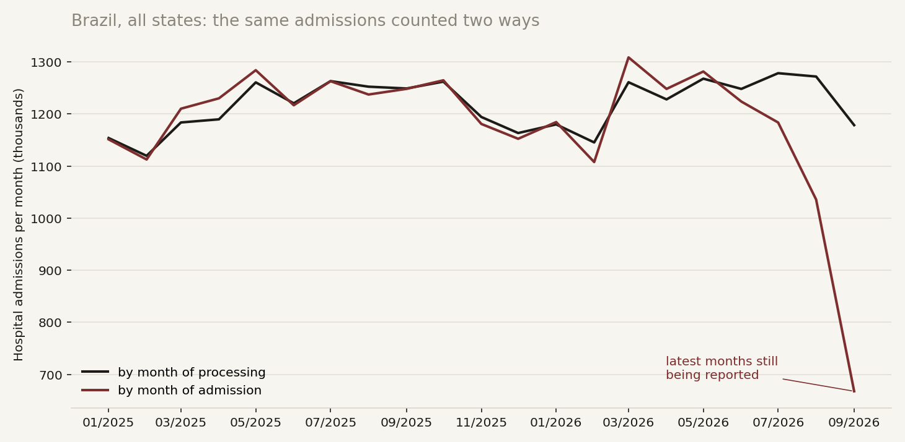
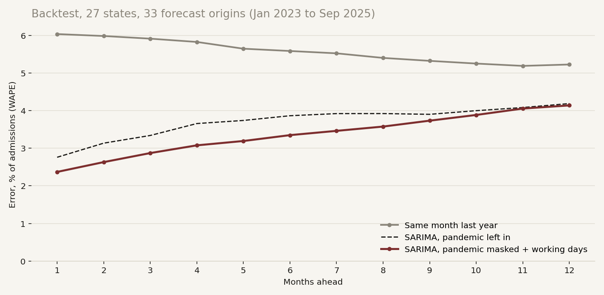
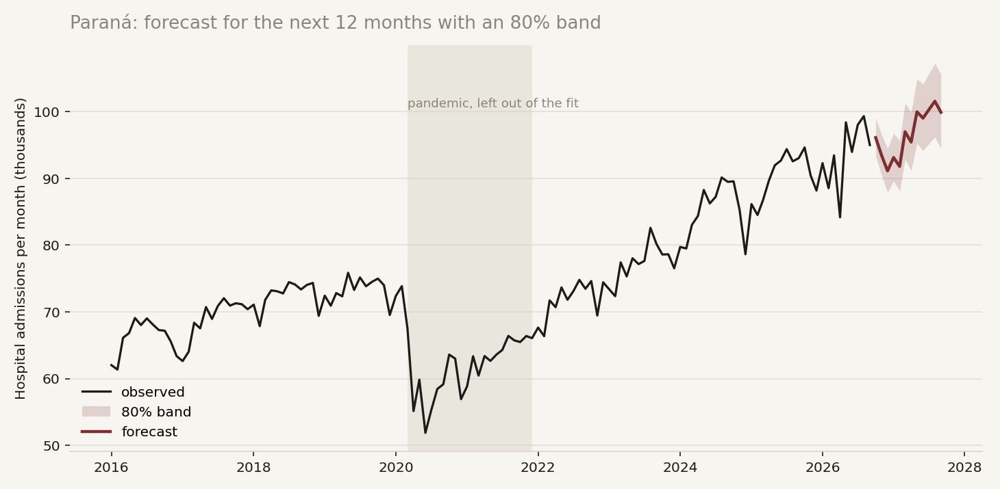

::: {.rh-section}
<div class="rh-kicker">Case Study 07 · Live</div>
# Forecasting Hospital Admissions

<p style="font-family:'IBM Plex Mono',monospace; font-size:.8rem; letter-spacing:.02em;">
Time series · Seasonal ARIMA · Rolling-origin backtest · 80% bands checked for coverage · Python · 19 tests
</p>
:::

::: {.rh-section}
## The business question

Beds, nursing shifts, supplies and the budget behind them are committed months in
advance, and all of them depend on one number: how many patients will be admitted. A
state health department, a hospital network and a health plan all face it.

The usual answer is last year's figure for the same month, adjusted by feel. It is
simple, and it is a fair benchmark. The question here is how much better a model does
on months it has not seen, and whether the range around its forecast can be trusted
when someone sizes a team on it.
:::

::: {.rh-section}
## The data

Public data from DATASUS: every hospital admission paid by SUS, Brazil's public health
system, counted by state and month from January 2008 to September 2026. That is 27
series, and about 1.2 million admissions a month for the country as a whole.

The same admissions can be counted by the month the patient was admitted or by the
month the hospital's bill was processed. The first looks like the obvious choice. For
the latest months it is wrong, because hospitals send their records late:



A model fitted on that line would see demand collapsing in the third quarter of 2026.
Nothing collapsed; the paperwork was late. The forecast uses the processing month.

The processing month has its own flaw: now and then a state's batch does not arrive.
Acre shows zero admissions in August and September 2026, and Roraima drops from about
4,000 a month to 517 and then to zero. Those are missing records, not missing patients.
:::

::: {.rh-section}
## Method, and why this one

**Missing data is called missing.** A month below 60% of the median of the previous 12
is treated as a batch that never arrived and left out. The rule looks only at the past,
so it works on the most recent month. It flags 9 months in 3 states.

**The pandemic is left out of the fit.** From March 2020 to December 2021 elective care
stopped and then caught up. Those months describe a shock, not the seasonal pattern the
forecast has to reproduce, so the model skips them as if they were missing.

**A simple model, with the calendar as its only outside input.** Seasonal ARIMA on the
log of admissions, the specification known as the airline model, with the number of
working days in each month as a regressor. Elective admissions happen on working days,
and a February with Carnival has two fewer of them than one without. The calendar is
known in advance, so the forecast can use it honestly. Adding it cuts the error over
the first three months from 2.82% to 2.62% of the volume.

**Tested the way it would be used.** At each of 33 dates, from January 2023 to
September 2025, the model is refitted on the data available at that date and forecasts
the next 12 months, for every state. That gives 891 twelve-month forecasts to score.
The benchmark goes through exactly the same test. Each decision above has its own
variant in the test, so its effect is measured rather than assumed.

The error measure is WAPE: total absolute error divided by total admissions. It reads
as "off by X% of the volume", and small states do not dominate it.
:::

::: {.rh-section}
## Result



| Error, % of admissions (WAPE) | 1 to 3 months | 4 to 6 months | 7 to 12 months |
|---|---|---|---|
| Same month last year | 5.98 | 5.69 | 5.32 |
| Model, pandemic left in | 3.08 | 3.75 | 4.00 |
| Model, pandemic left out | 2.82 | 3.35 | 3.92 |
| **Model, pandemic left out, with working days** | **2.62** | **3.21** | **3.81** |

Over the first three months the error falls by more than half, from 6.0% to 2.6% of
the volume. The model beats the benchmark in **all 27 states**. For the 12-month total,
the figure a budget is built on, the typical error is **2.7%** against **4.5%**, and in
the worst tenth of cases **7.0%** against **9.1%**.

The bigger difference is in the range around the forecast. A band labelled 80% should
contain the actual value about 80% of the time. With the pandemic left in, the model
learns that the world can fall apart at any moment. Its band ends up 15% to 27% of the
forecast wide and contains the actual value 87% to 96% of the time. A plan sized on
that band carries beds and staff it will not need. With the pandemic left out, the band
is **10% to 16%** wide and contains the actual value **80% to 83%** of the time, which
is what it promises.

The forecast for the next twelve months, Paraná as an example:



About 1.16 million admissions over the twelve months, 3.8% more than in the previous
twelve. The repository has the same forecast for every state.

The limits are part of the result. Small states are hard for every model: Roraima and
Amapá stay above 16% error. State totals are the right level for a health department,
while a hospital needs the same pipeline on its own cut of the data. And the pandemic
window was set by hand. A shock of that size would call for the same decision again.
:::

::: {.rh-section}
## Applied to your data

This is the
<a href="../oquant.html#packages">Custom Forecasting package</a> on public data:
admissions here, and in your case demand, claims, exams or default. The steps are the
same: find what in the data is a recording artifact, beat a simple benchmark on months
the model has not seen, and deliver a band that holds what it promises.
:::

::: {.rh-section}
## Code

```{=html}
<p><a class="rh-btn rh-btn-primary" href="https://github.com/rhozon/hospital-admissions-forecast">github.com/rhozon/hospital-admissions-forecast</a></p>
```

With Python 3.11 or later:

```bash
pip install -e ".[dev]"
pytest -v
python -m admissions.cli backtest
python -m admissions.cli forecast
python -m admissions.cli figures
python -m admissions.cli fetch    # refresh the data from DATASUS
```

The repository includes a snapshot of the DATASUS data, so the backtest reproduces
without network access. The suite has **19 tests**, among them a parser test on real
DATASUS output and hand-checked working-day counts. CI runs them on every push,
followed by a short backtest. The README lists the design decisions and the limits.
:::
