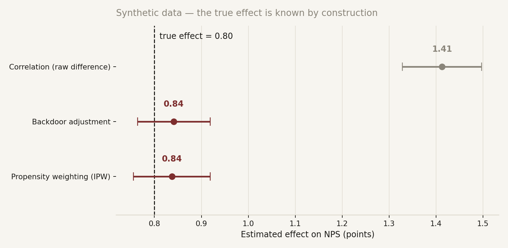

::: {.rh-section}
<div class="rh-kicker">Estudo de Caso 04 · Dados sintéticos</div>
# Modelagem Causal do NPS

<p style="font-family:'IBM Plex Mono',monospace; font-size:.8rem; letter-spacing:.02em;">
Inferência causal · Ajuste por backdoor · Ponderação por propensão · Python
</p>

```{=html}
<div class="rh-card" style="border-left:3px solid #7d2e2e;">
  <p style="margin:0;"><strong>Todo número e todo gráfico desta página vêm de dados
  simulados.</strong> O projeto real por trás deste método está coberto por acordo de
  confidencialidade: o cliente não é nomeado, e nenhum dado, número ou achado dele aparece
  aqui nem em qualquer outro lugar deste site. O que se mostra é o método, rodando sobre
  dados gerados pelo script no fim da página.</p>
</div>
```
:::

::: {.rh-section}
## A pergunta de negócio

Uma empresa mantém um programa de sucesso do cliente — uma ligação proativa para contas
que parecem precisar de ajuda. Seis meses depois, as contas que receberam a ligação têm
NPS visivelmente melhor. A liderança quer expandir o programa.

Deve? O painel mostra uma diferença. Ele não mostra se o programa **causou** a diferença,
ou se o time simplesmente ligou para as contas que já iam ficar satisfeitas — as grandes,
as de casa há mais tempo, as com poucas reclamações. Expandir um programa apoiado nessa
diferença pode queimar orçamento em algo que não faz nada.
:::

::: {.rh-section}
## Os dados

Simulados: 6.000 contas, cada uma com porte, tempo de casa, número de chamados de suporte,
se recebeu a intervenção e uma nota de NPS.

O confundimento é deliberado, e é justamente o ponto. No simulador, contas maiores e mais
antigas são **ao mesmo tempo** mais propensas a receber a ligação **e** mais satisfeitas de
partida. É exatamente essa estrutura que torna a comparação bruta enganosa, e é a cara de
um dado real de sucesso do cliente.

**Por que sintético é a escolha certa aqui, e não um remendo.** Com dado de cliente,
ninguém lendo esta página conseguiria conferir se a estimativa causal está certa — o efeito
verdadeiro é inobservável, que é a dificuldade central da área. Aqui o efeito verdadeiro é
uma constante escrita no código. Isso torna o estimador corrigível: dá para ver se ele
recupera a resposta, e por quanto erra.
:::

::: {.rh-section}
## O método, e por que esse

**A comparação ingênua, como referência.** Diferença de NPS médio entre contas tratadas e
não tratadas. É o que o painel reporta, e é o número sobre o qual a decisão se apoiaria.

**Ajuste por backdoor.** Regredir o NPS sobre a intervenção condicionando nas variáveis que
dirigem tanto a intervenção quanto o desfecho — porte, tempo de casa, chamados. Bloquear
esses caminhos deixa o efeito causal.

**Ponderação por propensão.** Modelar a probabilidade de receber a ligação dadas as mesmas
covariáveis e ponderar cada conta pelo inverso dessa probabilidade. Isso reconstrói uma
população em que o tratamento é tão bom quanto sorteado, e faz um conjunto de premissas
diferente do da regressão — então concordância entre os dois é informativa, e discordância
seria um alerta.

Dois estimadores em vez de um, de propósito. Uma estimativa causal isolada é uma
afirmação; duas que se apoiam em premissas diferentes e caem no mesmo lugar são evidência.
:::

::: {.rh-section}
## O resultado



O efeito verdadeiro escrito no simulador é de **0,80 ponto de NPS**.

A comparação bruta reporta **1,41** — superestima o programa em cerca de três quartos,
porque credita à intervenção a vantagem de partida das contas que a receberam. Um time que
expandisse o programa com base nesse número veria o retorno silenciosamente não aparecer.

Os dois estimadores causais chegam a **0,84**, com a verdade dentro dos intervalos de
confiança, e concordam entre si apesar de partirem de premissas diferentes.

O ponto não são as casas decimais. É que a distância entre 1,41 e 0,80 é a diferença entre
um programa que justifica seu orçamento e um que basicamente reetiqueta clientes que já
eram fiéis — e nenhum filtro adicional no painel teria revelado isso.
:::

::: {.rh-section}
## O código

O script gera os dados, roda os três estimadores e produz o gráfico acima. É autocontido e
determinístico — mesma semente, mesmos números:

```{=html}
<p><a class="rh-btn rh-btn-primary" href="../../portfolio/nps-causal-demo.py">nps-causal-demo.py</a></p>
```

```bash
python nps-causal-demo.py
```

Exige `numpy`, `pandas`, `statsmodels` e `matplotlib`. Mude `EFEITO_VERDADEIRO` no topo e
rode de novo: a estimativa ingênua se move com o confundimento, as ajustadas seguem a
verdade.
:::

::: {.rh-section}
## Referências

- Austin, P. C. and Stuart, E. A. (2015). Moving towards best practice when using inverse probability of treatment weighting (IPTW) using the propensity score to estimate causal treatment effects in observational studies. *Statistics in Medicine*, 34(28), 3661-3679. [doi:10.1002/sim.6607](https://doi.org/10.1002/sim.6607)
- Hirano, K., Imbens, G. W. and Ridder, G. (2003). Efficient Estimation of Average Treatment Effects Using the Estimated Propensity Score. *Econometrica*, 71(4), 1161-1189. [doi:10.1111/1468-0262.00442](https://doi.org/10.1111/1468-0262.00442)
- Keiningham, T. L., Cooil, B., Andreassen, T. W. and Aksoy, L. (2007). A Longitudinal Examination of Net Promoter and Firm Revenue Growth. *Journal of Marketing*, 71(3), 39-51. [doi:10.1509/jmkg.71.3.039](https://doi.org/10.1509/jmkg.71.3.039)
- Pearl, J. (2009). Causality: Models, Reasoning, and Inference, 2nd ed. *Cambridge University Press*. [doi:10.1017/CBO9780511803161](https://doi.org/10.1017/CBO9780511803161)
- Rosenbaum, P. R. and Rubin, D. B. (1983). The central role of the propensity score in observational studies for causal effects. *Biometrika*, 70(1), 41-55. [doi:10.1093/biomet/70.1.41](https://doi.org/10.1093/biomet/70.1.41)
:::
