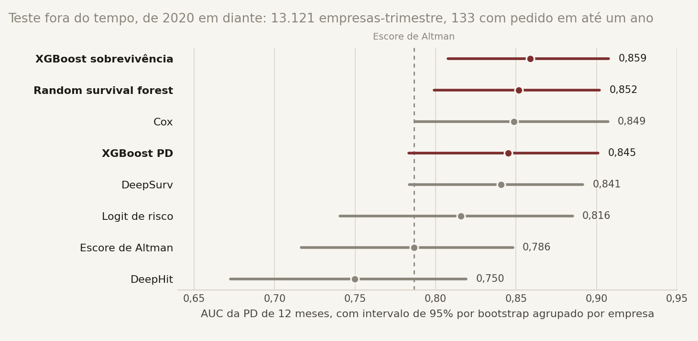

::: {.rh-section}
<div class="rh-kicker">Estudo de Caso 08 · Resultados em revisão</div>
# Alerta Antecipado de Risco de Crédito Corporativo

<p style="font-family:'IBM Plex Mono',monospace; font-size:.8rem; letter-spacing:.02em;">
Análise de sobrevivência · XGBoost · DeepSurv · DeepHit · Sinais lidos por modelos de linguagem · Agentes com trava numérica · Revisão sistemática · Python · 192 testes
</p>
:::

::: {.rh-section}
## A pergunta de negócio

Quando uma grande empresa pede recuperação judicial, a perda cai sobre bancos, debenturistas,
fundos de crédito e os fornecedores que venderam a prazo. A Oi pediu duas vezes, em 2016 e
em 2023. A Americanas pediu em janeiro de 2023, dias depois de divulgar uma inconsistência
contábil. A Light veio em maio de 2023. Depois de cada caso, o comitê de crédito faz a mesma
pergunta: havia algo no registro público, um ano antes, que devia ter mudado a decisão?

Desde janeiro de 2025 a pergunta tem também forma regulatória. A Resolução CMN 4.966 pede
aos credores brasileiros provisão pela perda esperada: os próximos 12 meses para exposições
sem problema, o prazo inteiro quando o risco de crédito aumenta de forma significativa. Isso
exige uma probabilidade de default para cada horizonte, não um escore único, e exige
perceber o aumento cedo.
:::

::: {.rh-section}
## Os dados

Tudo é público. As demonstrações trimestrais e anuais de todas as companhias abertas vêm do
portal de dados abertos da CVM, cada uma datada pelo dia em que chegou ao regulador, então o
modelo só vê o que um analista poderia ter visto na época. O parecer do auditor é lido em
busca do parágrafo de continuidade operacional. Os fatos relevantes, que a empresa é obrigada
a publicar quando algo importante acontece, trazem a notícia cedo: uma renegociação de
dívida, um waiver de covenant, uma venda de ativo para fazer caixa, um diretor financeiro que
sai. Juros, inflação, atividade, desemprego e inadimplência das empresas vêm do Banco
Central.

A parte difícil é o desfecho. Nenhuma tabela pública diz quando cada companhia aberta entrou
em recuperação judicial ou extrajudicial; o cadastro mostra só a situação atual. A base de
eventos foi reconstruída a partir de três rastros públicos (o cadastro, os documentos das
empresas em recuperação e os fatos relevantes que anunciam o pedido), com um modelo de
linguagem separando o pedido da própria empresa do pedido de um cliente ou de uma controlada,
e depois conferida por um segundo modelo, que lê os documentos de cada evento, com uma
regra fixa. São 103 eventos em 87 empresas desde 2011.
:::

::: {.rh-section}
## O método, e por que este

**Um painel, um teste, oito modelos.** Cada companhia aberta não financeira entra com uma
linha por trimestre, com o que se sabia no fim daquele trimestre. Empresas que saíram da
bolsa sem evento ficam nos dados até sair, então a amostra não guarda só as sobreviventes. Os
modelos vão do clássico ao recente: o escore de Altman na versão para emergentes, um logit
de risco em tempo discreto, um modelo de Cox, XGBoost como classificador e como modelo de
sobrevivência, uma random survival forest, DeepSurv e DeepHit. Todos treinam até 2018,
pulam 2019 e são testados de 2020 em diante, um período que nenhum deles viu.

**Modelos de sobrevivência, porque a regulação pede curvas.** Um modelo de sobrevivência dá a
probabilidade de default em 12, 24 e 36 meses para cada empresa e trimestre, que é o que a
perda esperada pelo prazo inteiro precisa. Se essas probabilidades estão calibradas, e não só
se ordenam bem as empresas, é testado à parte.

**Modelos de linguagem leem os documentos, e são testados como qualquer outra variável.** Um
modelo lê o assunto de cerca de 31 mil fatos relevantes e marca onze tipos de estresse, com
o nome e o CNPJ da empresa escondidos, para que ele não lembre como a história terminou. Um
segundo modelo lê uma amostra para medir a concordância, e 200 documentos foram lidos
inteiros para ver o que o assunto sozinho perde. O teste que diz se
esses sinais acrescentam algo foi escrito e registrado antes de o período de teste ser
aberto.

**Um parecer de crédito que não inventa número.** Agentes montam um parecer para o comitê de
crédito: um lê os documentos recentes, outro escreve. Um conferente que não é modelo de
linguagem compara cada número e cada data do rascunho com os valores que as ferramentas
devolveram, e bloqueia o parecer se algum não tiver fonte.
:::

::: {.rh-section}
## Resultado

**Resultados em revisão.** Uma revisão do código, em 23 de novembro de 2026, achou dois erros
que mudam resultados publicados. A regra que lê o parágrafo de continuidade operacional no
parecer do auditor também pegava uma frase-padrão que todo parecer traz desde 2017, então a
marcação ficou errada para a maioria dos documentos desde então, inclusive no parecer sobre a
Casas Bahia. E a conferência da calibração só guardava janelas ainda não encerradas quando
terminavam em default, o que inflou as taxas observadas. A conclusão sobre calibração, os
pareceres e o artigo ficam retirados até a rodada corrigida ser publicada aqui, com errata. Os
números abaixo vêm da rodada que está sendo corrigida.



Fora do tempo, de 2020 em diante, os modelos de árvores ordenam melhor as empresas. XGBoost e
uma random survival forest chegam a uma AUC de cerca de 0,85 na PD de 12 meses, contra 0,78 do
escore de Altman e 0,76 do logit de risco, diferença que resiste à correção de Holm para
comparações múltiplas. As redes neurais não repetem o ganho num painel deste tamanho.

Os sinais lidos pelos modelos de linguagem não melhoraram o teste registrado: AUC de 0,756 com
eles e de 0,758 sem eles. O artigo mostra também uma falha encontrada depois da abertura do
teste: o tratamento dos valores extremos apagou os cinco tipos de sinal mais raros (quebra de
covenant, atraso de pagamento, dúvida sobre continuidade, rebaixamento de rating e recuperação
de uma controlada). Rodado de novo com eles, o modelo com sinais chega a uma AUC de 0,783. Essa
rodada veio depois da abertura, então é exploratória e precisa de um novo período de teste
para valer.

Os pareceres de quatro casos passados, escritos com o que se sabia um ano antes de cada pedido,
estão sendo refeitos com a regra de continuidade corrigida.
:::

::: {.rh-section}
## O que a literatura fez e não fez

Uma revisão sistemática pelo protocolo PRISMA 2020 triou 4.019 estudos e incluiu 1.642.
Modelos de sobrevivência aparecem em 96 deles, e só um estudo combina modelos de
sobrevivência com modelos de linguagem. Dos 59 estudos com dados brasileiros, um usa modelo
de sobrevivência e nenhum usa deep learning ou modelo de linguagem. A maioria dos resumos não
diz como os modelos foram validados, e ler 60 estudos inteiros não muda muito o quadro: 32
deles continuam sem dizer como montaram a amostra de teste, e só 10 conferem se as
probabilidades estão calibradas, que é do que a provisão depende. O artigo traz o protocolo,
as contagens e as lacunas.
:::

::: {.rh-section}
## Aplicado à sua carteira

Este é o
<a href="../oquant.html#pacotes">pacote de Previsão sob Medida</a> aplicado a default, com a
trava do <a href="../oquant.html#pacotes">Assistente de IA Confiável</a> por cima. Para um
banco, um fundo de crédito, uma seguradora de garantia ou um fornecedor com muito a receber,
ele vira um monitor das empresas da carteira: os documentos lidos todo dia, uma curva de PD
por empresa todo mês, um alerta quando aparece um sinal de estresse e um parecer para o
comitê de crédito em que cada número leva à sua fonte. Roda no seu ambiente, e a decisão
fica com a sua equipe.

Em público, o case só cita empresas que já passaram por recuperação. Os modelos dão nota a
todas as companhias abertas, mas essas notas ficam privadas.
:::

::: {.rh-section}
## Artigo e código

```{=html}
<p>
<a class="rh-btn" href="https://github.com/rhozon/corporate-credit-early-warning">github.com/rhozon/corporate-credit-early-warning</a>
</p>
```

Com Python 3.11 ou mais recente:

```bash
pip install -e ".[models,dev]"
pytest -v
python -m distress.cli events      # base de eventos a partir da CVM
python -m distress.cli panel       # painel datado pelo que se sabia
python -m distress.cli test        # o teste fora do tempo
```

Toda resposta dos modelos de linguagem fica em cache no repositório, então os rótulos se
reproduzem sem chave de API. A suíte tem **192 testes**, entre eles um que derruba o
build se algo publicado citar uma empresa sem evento ao lado de uma probabilidade ou de uma
nota. O CI roda os testes a cada push. O README em inglês lista as decisões de projeto e os
limites.
:::
