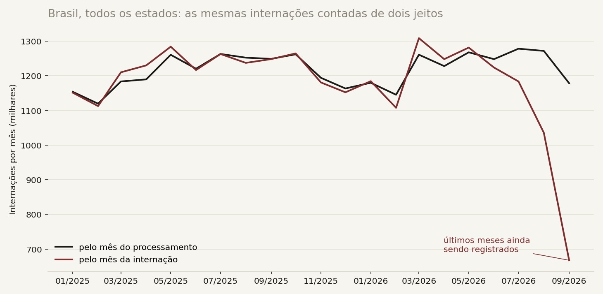
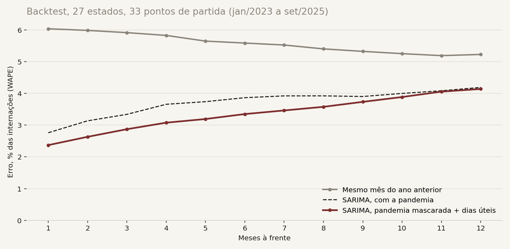
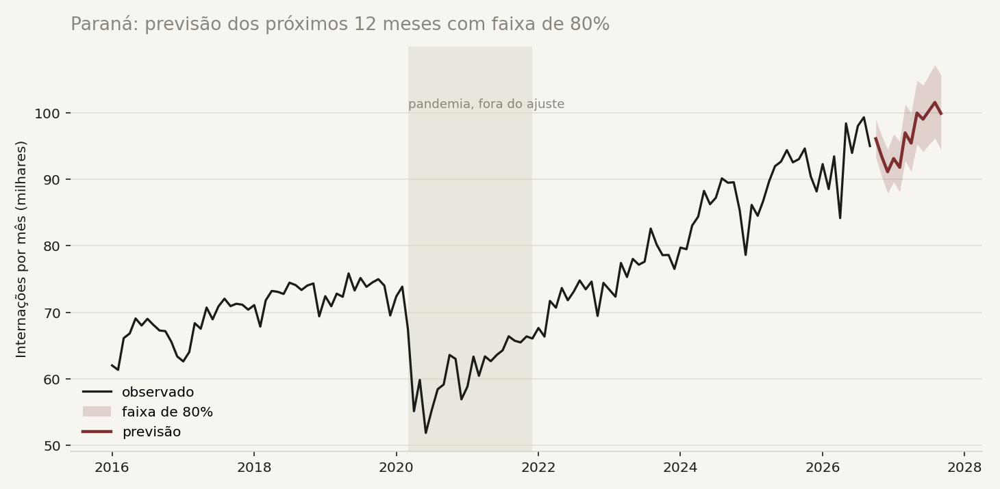

::: {.rh-section}
<div class="rh-kicker">Estudo de Caso 07 · No ar</div>
# Previsão de Internações Hospitalares

<p style="font-family:'IBM Plex Mono',monospace; font-size:.8rem; letter-spacing:.02em;">
Séries temporais · SARIMA sazonal · Backtest com origem móvel · Faixas de 80% conferidas · Python · 21 testes
</p>
:::

::: {.rh-section}
## A pergunta de negócio

Leitos, escalas de enfermagem, insumos e o orçamento por trás deles são comprometidos
com meses de antecedência, e tudo depende de um número: quantos pacientes vão ser
internados. Secretaria de saúde, rede hospitalar e operadora de plano enfrentam a mesma
pergunta.

A resposta de costume é o número do mesmo mês do ano anterior, ajustado no olho. É
simples e é uma referência justa. A pergunta aqui é quanto um modelo acerta a mais em
meses que ele não viu, e se a faixa em volta da previsão merece confiança na hora de
dimensionar uma equipe com ela.
:::

::: {.rh-section}
## Os dados

Dados públicos do DATASUS: todas as internações pagas pelo SUS, contadas por estado e
por mês, de janeiro de 2008 a setembro de 2026. São 27 séries, e cerca de 1,2 milhão de
internações por mês no país inteiro.

As mesmas internações podem ser contadas pelo mês em que o paciente foi internado ou
pelo mês em que a conta do hospital foi processada. A primeira parece a escolha óbvia.
Para os meses mais recentes, ela está errada, porque os hospitais mandam os registros
com atraso:



Um modelo ajustado sobre essa linha veria a demanda despencar no terceiro trimestre de
2026. Nada despencou; a papelada atrasou. A previsão usa o mês de processamento.

O mês de processamento tem a sua própria falha: de vez em quando o lote de um estado não
chega. O Acre aparece com zero internações em agosto e setembro de 2026, e Roraima cai
de cerca de 4.000 por mês para 517 e depois para zero. São registros que faltam, não
pacientes que faltam.
:::

::: {.rh-section}
## O método, e por que esse

**Dado que falta é tratado como falta.** Um mês abaixo de 60% da mediana dos 12
anteriores é tratado como um lote que não chegou e fica de fora. A regra olha só para
trás, então funciona no mês mais recente. Ela marca 9 meses em 3 estados.

**A pandemia fica fora do ajuste.** De março de 2020 a dezembro de 2021 as cirurgias
eletivas pararam e depois foram retomadas. Esses meses descrevem um choque, não o padrão
sazonal que a previsão precisa reproduzir, então o modelo os pula como se faltassem.

**Um modelo simples, com o calendário como única informação de fora.** SARIMA sazonal
sobre o log das internações, a especificação conhecida como modelo airline, com o número
de dias úteis de cada mês como regressor. Internação eletiva acontece em dia útil, e um
fevereiro com Carnaval tem dois dias úteis a menos do que um sem. O calendário é
conhecido com antecedência, então a previsão pode usá-lo de forma honesta. Incluí-lo
reduz o erro dos três primeiros meses de 2,82% para 2,62% do volume.

**Testado do jeito que seria usado.** Em cada uma de 33 datas, de janeiro de 2023 a
setembro de 2025, o modelo é reajustado com os dados disponíveis naquela data e prevê os
12 meses seguintes, para todos os estados. São 891 previsões de 12 meses para avaliar. A
referência passa exatamente pelo mesmo teste. Cada decisão acima tem a sua variante no
teste, então o efeito dela é medido, não suposto.

A medida de erro é o WAPE: erro absoluto total dividido pelo total de internações. Ele
se lê como "errou X% do volume", e os estados pequenos não dominam a conta.
:::

::: {.rh-section}
## O resultado



| Erro, % das internações (WAPE) | 1 a 3 meses | 4 a 6 meses | 7 a 12 meses |
|---|---|---|---|
| Mesmo mês do ano anterior | 5,98 | 5,69 | 5,32 |
| Modelo, com a pandemia | 3,08 | 3,75 | 4,00 |
| Modelo, sem a pandemia | 2,82 | 3,35 | 3,92 |
| **Modelo, sem a pandemia, com dias úteis** | **2,62** | **3,21** | **3,81** |

Nos três primeiros meses o erro cai a menos da metade, de 6,0% para 2,6% do volume. O
modelo vence a referência **nos 27 estados**. No total de 12 meses, o número em que um
orçamento se apoia, o erro típico é de **2,7%** contra **4,5%**, e nos 10% piores casos,
**7,0%** contra **9,1%**.

A diferença maior está na faixa em volta da previsão. Uma faixa de 80% deveria conter o
valor real cerca de 80% das vezes. Com a pandemia nos dados, o modelo aprende que o
mundo pode desabar a qualquer momento. A faixa fica com largura de 15% a 27% da
previsão e contém o valor real de 87% a 96% das vezes. Um plano dimensionado por ela
carrega leitos e equipe de que não vai precisar. Sem a pandemia, a faixa tem largura de
**10% a 16%** e contém o valor real de **80% a 83%** das vezes, que é o que ela promete.

A previsão dos próximos doze meses, com o Paraná de exemplo:



Cerca de 1,16 milhão de internações nos doze meses, 3,8% a mais do que nos doze
anteriores. O repositório tem a mesma previsão para todos os estados.

Os limites fazem parte do resultado. Estados pequenos são difíceis para qualquer modelo:
Roraima e Amapá ficam acima de 16% de erro. O total por estado é o nível certo para uma
secretaria de saúde, enquanto um hospital precisa do mesmo processo no seu próprio
recorte dos dados. E a janela da pandemia foi definida à mão. Um choque desse tamanho
pediria a mesma decisão de novo.
:::

::: {.rh-section}
## Experimente

Escolha um estado para ver o histórico e a previsão dos próximos doze meses; refaça qualquer uma das 33 previsões do teste contra o que de fato aconteceu, ao lado do benchmark ou do modelo com a pandemia no ajuste; ou compare o erro de cada modelo estado por estado.

```{=html}
<link rel="stylesheet" href="../../assets/case07/sim.css?v=1">
<div id="adm-app" data-src="../../assets/case07/data.json?v=1"></div>
<script src="https://cdnjs.cloudflare.com/ajax/libs/Chart.js/4.4.1/chart.umd.min.js"></script>
<script src="../../assets/case07/sim.js?v=1"></script>
```
:::

::: {.rh-section}
## Aplicado aos seus dados

Este é o
<a href="../oquant.html#pacotes">pacote de Previsão sob Medida</a> com dados públicos:
internações aqui e, no seu caso, demanda, sinistros, exames ou inadimplência. Os passos
são os mesmos: achar o que nos dados é artefato de registro, vencer uma referência
simples em meses que o modelo não viu e entregar uma faixa que cumpre o que promete.
:::

::: {.rh-section}
## O código

```{=html}
<p><a class="rh-btn rh-btn-primary" href="https://github.com/rhozon/hospital-admissions-forecast">github.com/rhozon/hospital-admissions-forecast</a></p>
```

Com Python 3.11 ou mais recente:

```bash
pip install -e ".[dev]"
pytest -v
python -m admissions.cli backtest
python -m admissions.cli forecast
python -m admissions.cli figures
python -m admissions.cli fetch    # atualiza os dados a partir do DATASUS
```

O repositório traz uma cópia dos dados do DATASUS, então o backtest se reproduz sem
internet. A suíte tem **21 testes**, entre eles um teste do leitor sobre saída real do
DATASUS e contagens de dias úteis conferidas à mão. O CI roda os testes a cada push,
seguidos de um backtest curto. O README em inglês lista as decisões de projeto e os
limites.
:::

::: {.rh-section}
## Referências

- Diebold, F. X. and Mariano, R. S. (1995). Comparing Predictive Accuracy. *Journal of Business & Economic Statistics*, 13(3), 253-263. [doi:10.1080/07350015.1995.10524599](https://doi.org/10.1080/07350015.1995.10524599)
- Gneiting, T. and Raftery, A. E. (2007). Strictly Proper Scoring Rules, Prediction, and Estimation. *Journal of the American Statistical Association*, 102(477), 359-378. [doi:10.1198/016214506000001437](https://doi.org/10.1198/016214506000001437)
- Hyndman, R. J. and Khandakar, Y. (2008). Automatic Time Series Forecasting: The forecast Package for R. *Journal of Statistical Software*, 27(3). [doi:10.18637/jss.v027.i03](https://doi.org/10.18637/jss.v027.i03)
- Hyndman, R. J. and Koehler, A. B. (2006). Another look at measures of forecast accuracy. *International Journal of Forecasting*, 22(4), 679-688. [doi:10.1016/j.ijforecast.2006.03.001](https://doi.org/10.1016/j.ijforecast.2006.03.001)
- Jones, S. S., Thomas, A., Evans, R. S., Welch, S. J., Haug, P. J. and Snow, G. L. (2008). Forecasting Daily Patient Volumes in the Emergency Department. *Academic Emergency Medicine*, 15(2), 159-170. [doi:10.1111/j.1553-2712.2007.00032.x](https://doi.org/10.1111/j.1553-2712.2007.00032.x)
- Tashman, L. J. (2000). Out-of-sample tests of forecasting accuracy: an analysis and review. *International Journal of Forecasting*, 16(4), 437-450. [doi:10.1016/S0169-2070(00)00065-0](https://doi.org/10.1016/S0169-2070(00)00065-0)
:::
